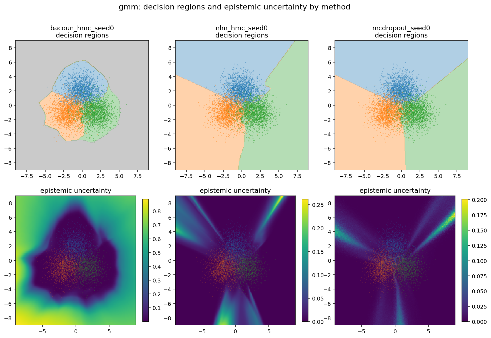
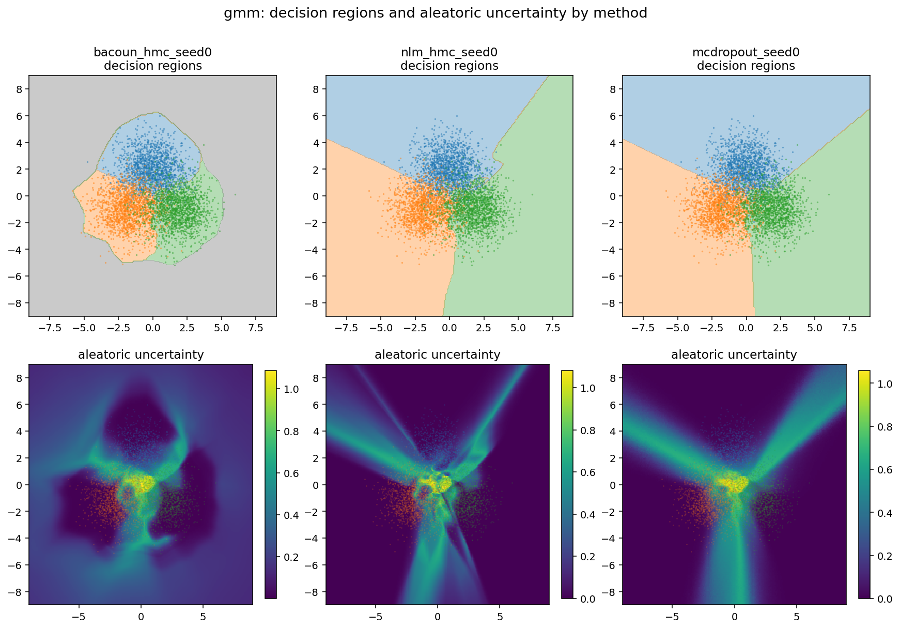
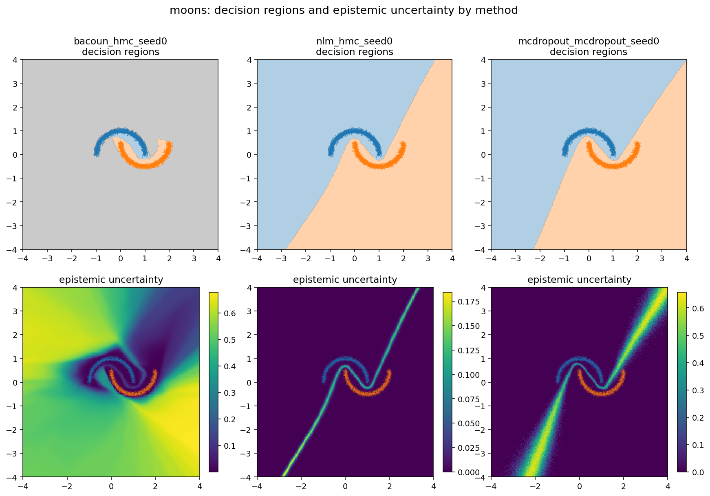
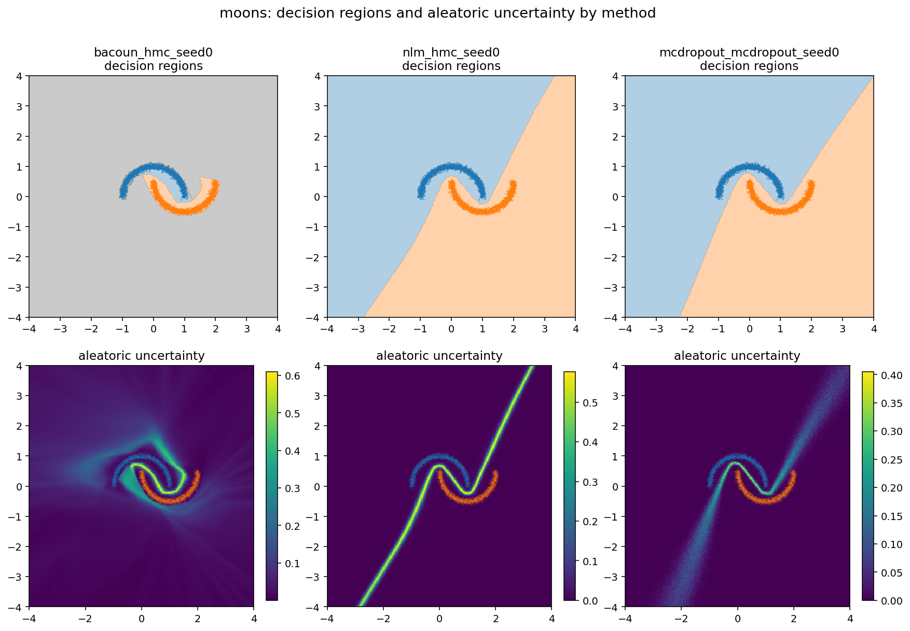
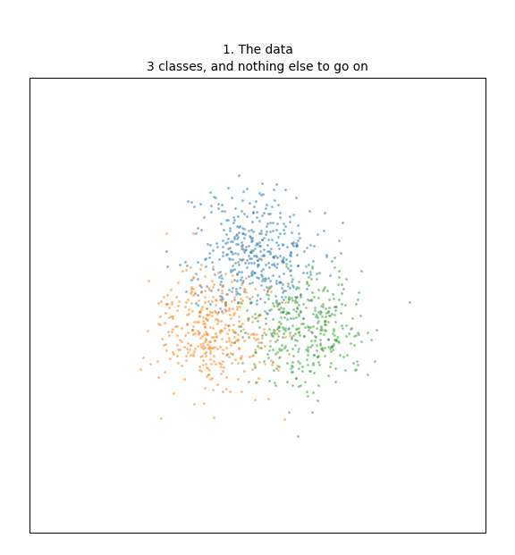

# BaCOUn — toy reproduction

Code for synthetic experiments (3-component Gaussian mixture, two moons) from

> **BaCOUn: Bayesian Classifiers with Out-of-Distribution Uncertainty.**
> Theo Guenais, Dimitris Vamvourellis, Yaniv Yacoby, Finale Doshi-Velez, Weiwei Pan.
> ICML 2020 Workshop on Uncertainty and Robustness in Deep Learning. [arXiv:2007.06096](https://arxiv.org/abs/2007.06096)

A neural linear model (deterministic features + Bayesian last layer) cannot express out-of-distribution (ood) uncertainty, because nothing in its objective asks the features to describe where the data ends. BaCOUn fits a density estimation (e.g normalizing flow) to the inputs, samples boundary points (thin shell in the flow's latent space), trains a `K+1`-class classifier with the boundary points as the extra class, then infers a Bayesian last layer on the frozen features. Uncertainty is split into aleatoric (expected entropy) and epistemic (mutual information).

## Results

Epistemic uncertainty separates test points from out-of-distribution rings (AUROC, mean ± std over 3 seeds; NUTS for the last layer). "Far" is a ring at radius 12, "near" a ring at 1.2× the data radius.

| dataset | method | accuracy | AUROC far | AUROC near |
|---|---|---|---|---|
| GMM | BaCOUn | 0.855 ± 0.009 | 1.000 ± 0.001 | 0.999 ± 0.002 |
| GMM | NLM (no boundary class) | 0.851 ± 0.007 | 0.303 ± 0.016 | 0.334 ± 0.039 |
| GMM | MC-Dropout | 0.854 ± 0.003 | 0.246 ± 0.033 | 0.304 ± 0.036 |
| Moons | BaCOUn | 1.000 | 0.987 ± 0.023 | 0.977 ± 0.038 |
| Moons | NLM | 1.000 | 0.016 ± 0.007 | 0.139 ± 0.022 |
| Moons | MC-Dropout | 1.000 | 0.099 ± 0.017 | 0.215 ± 0.011 |

An AUROC below 0.5 means the model is *more* confident away from the data than on it.






The pipeline end to end (flow → latent shell → boundary points → classifier → posterior samples):



Ablations: 1) the network with and without the boundary class, seen in feature space (`figures/features_gmm.png`); 2) a flat-logit penalty at the boundary points, which works as well as the extra class (`figures/mechanism_gmm_samples.png`).

## Reproduce

Requires Python ≥ 3.11 and [uv](https://docs.astral.sh/uv/). CPU is enough (about one hour for the full set).

```bash
uv sync
uv run python src/main.py --reproduce --device cpu     # every run above, then the summary figures
```

Single runs and the extra studies:

```bash
uv run python src/main.py --dataset gmm --inference hmc      # BaCOUn, NUTS
uv run python src/main.py --dataset gmm --method nlm         # baseline: no boundary class
uv run python src/main.py --dataset moons --method mcdropout # baseline: MC-Dropout
uv run python src/main.py --summarize                        # rebuild figures from saved grids
uv run python src/animate.py --dataset gmm                   # the workflow animation
uv run python src/features.py --dataset gmm                  # feature-space comparison
uv run python src/mechanism.py --dataset gmm                 # penalty vs extra class
```

Each run writes `results/<tag>/metrics.json` (config, metrics, git commit) and its figures; `results/report.md` collects one row per run. Same seed and same commit reproduce a run exactly.

## Layout

Pipeline, in four steps:

1. Density estimation: fit a RealNVP flow to the inputs by maximum likelihood.
   * `nets.RealNVP`, `main.train_flow`
2. Boundary points: sample a thin shell `{3 < ‖z‖ < 3.1}` in the flow's latent space and map it back to data space; this is class `K`.
   * `data.sample_latent_shell`, `data.boundary_points`
3. Classifier: train a feed-forward net on the `K+1` classes.
   * `nets.Classifier`, `main.train_classifier`
4. Bayesian last layer: drop the boundary points, freeze the features, infer a new last layer for the `K` real classes with mean-field BBVI or NUTS.
   * `bayes.model`, `bayes.fit_bbvi`, `bayes.fit_hmc`, `bayes.posterior_predictive`

Around the pipeline:

* `data.py` — datasets (3-component GMM, two moons), Bayes-optimal accuracy of the GMM, far-field probe rings
* `metrics.py` — uncertainty decomposition (total = aleatoric + epistemic), accuracy, AUC, OOD separation AUROC, radial profiles
* `bayes.py` — also the MC-Dropout baseline (`mc_dropout_predict`); the NLM baseline is `main.py --method nlm`
* `utils.py` — success criteria (`CRITERIA`), per-run `metrics.json`, `results/report.md`, device, seeding, git provenance
* `main.py` — entry point: single runs, `--reproduce`, `--summarize`, `--grid-search`
* `pipeline.py` — cached flow + classifier used by the three scripts below
* `features.py` — the same network with and without the boundary class, in feature space
* `mechanism.py` — ablation: extra class vs flat-logit penalty vs plain
* `animate.py` — the pipeline as an animation
* `plot.py` — all figures

## Note

This project originates from our original BaCOUn codebase, refreshed and cleaned up with the help of an AI assistant (the figures, in particular are fully AI-(re)-generated). We are currently working on large-scale extensions!
